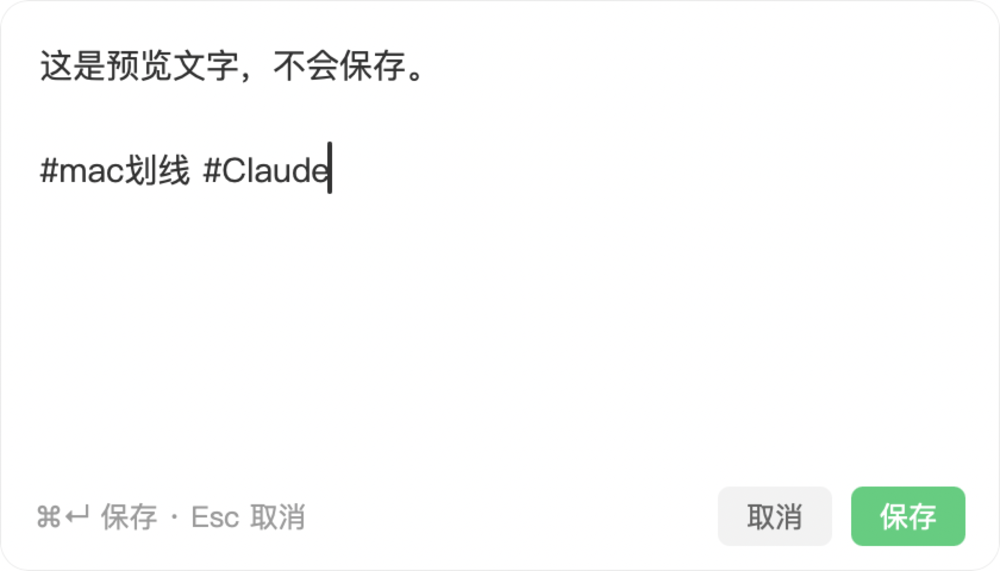

# flomo-clip

在 Mac 上任意软件里选中一段文字，按 `Ctrl+F`，就把它存进 [flomo](https://flomoapp.com)，并自动打上 `#mac划线` 和来源标签（比如 `#Claude`、`#ChatGPT`）。存完后右下角会弹出一个小提示，点「编辑」可以直接修改刚存的这条笔记。

基于 [Hammerspoon](https://www.hammerspoon.org)，两个 Lua 文件，没有其他依赖。

*Select text in any macOS app, press Ctrl+F, and it is saved to flomo with a source tag. A small toast lets you edit the note you just saved.*




## 功能

- **任意软件可用**：通过模拟 `⌘C` 取选中文字，取完后把剪贴板恢复原样。
- **自动识别来源**：用当前软件名作标签；在 Chrome、Safari 里还会看网址，claude.ai 记为 `#Claude`，chatgpt.com 记为 `#ChatGPT`。
- **右下角小提示**：半透明，风格接近 flomo，几秒后自动消失；鼠标停在上面时不会消失。
- **存完直接编辑**：点提示上的「编辑」，弹出小编辑框，`⌘↵` 保存写回原笔记，`Esc` 取消。

## 需要

- macOS 和 [Hammerspoon](https://www.hammerspoon.org)（在 1.1.1 上测试过）
- flomo 会员：存笔记用的是 flomo API，需要 PRO
- 「编辑」功能需要在浏览器里授权一次 flomo（见下文）

## 安装

1. 安装 Hammerspoon，并在「系统设置 → 隐私与安全性 → 辅助功能」里允许它：

   ```bash
   brew install --cask hammerspoon
   ```

2. 把 `flomo_clip.lua` 和 `flomo_mcp.lua` 放进 `~/.hammerspoon/`，然后在 `~/.hammerspoon/init.lua` 里加一行：

   ```lua
   require("flomo_clip")
   ```

3. 在 flomo「设置 → 扩展中心 → API」复制你的 API 地址，保存到 `~/.hammerspoon/flomo_api_url.txt`（文件里只要有这个地址就行）。

4. 在菜单栏的 Hammerspoon 图标里点 Reload Config。

第一次在 Chrome 或 Safari 里划线时，系统会问是否允许 Hammerspoon 控制浏览器，点允许，否则认不出网站。

## 设置

改 `flomo_clip.lua` 开头「可按需修改的设置」这一段：

| 设置 | 默认 | 说明 |
| --- | --- | --- |
| `HOTKEY` | `Ctrl+F` | 快捷键 |
| `BASE_TAG` | `mac划线` | 每条划线都带的标签，不能有空格 |
| `APP_TAGS` | `Google Chrome → Chrome` | 软件名到标签的映射，没列出的软件直接用软件名 |
| `SITE_TAGS` | claude.ai、chatgpt.com | 在浏览器里按网站识别来源 |

改完后 Reload Config。

## 编辑功能是怎么工作的

flomo 的 API 地址只能新建笔记，不能修改；桌面端也没有能直接进入编辑的链接。所以「编辑」用的是 flomo 官方的 [MCP 接口](https://flomoapp.com/mcp)：

- 第一次点「编辑」会打开浏览器，在 flomo 的页面上授权（OAuth + PKCE）。授权结果由本机 `127.0.0.1:53682` 上的临时页面接收，收到后立即关闭。
- 授权凭证保存在 `~/.hammerspoon/flomo_oauth.json`，权限 600，过期会自动刷新。想撤销授权，删掉这个文件即可。
- 保存时调用 `memo_update`，用编辑框里的内容覆盖这条笔记。

## 注意

- `Ctrl+F` 在 macOS 输入框和终端里原本是「光标右移一格」，绑定后这个功能会被占用。介意的话把 `HOTKEY` 换成别的组合。
- 编辑框里是你刚存的原文。如果在这期间你已经在 flomo 里改过这条笔记，保存会覆盖那次修改。
- 「编辑」按钮只在提示显示期间可用；提示消失后请回 flomo 里修改。
- 发出去的只有你选中的文字（发给 flomo）。浏览器网址只在本机用来判断标签，不会上传。

## 许可

[MIT](LICENSE)
